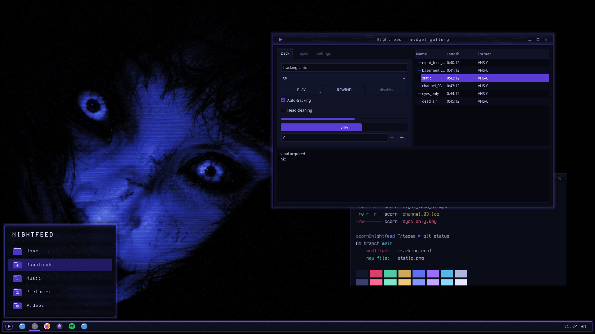
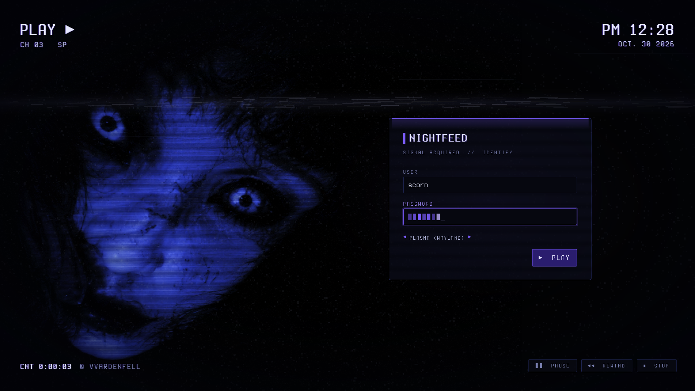
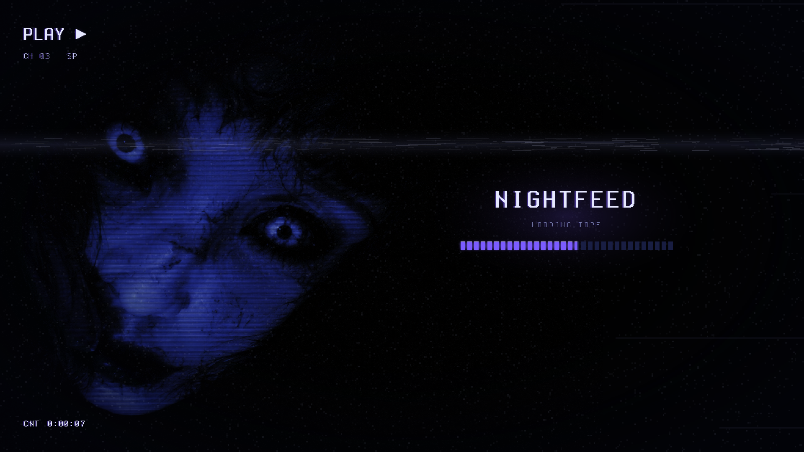
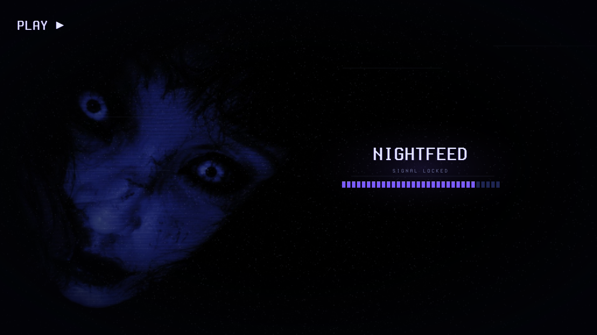
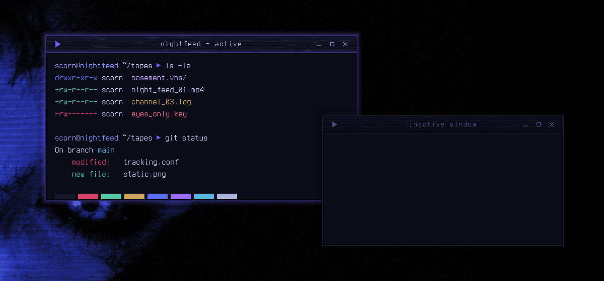

# Nightfeed

A night-vision VHS look for KDE Plasma 6, built around a cobalt-lit face on near-black:
cobalt-black surfaces, faint scanlines and tape grain, and a slight violet glow on whatever has focus.
It is the whole desktop, from the boot splash and login screen down to the terminal colours,
all generated from one palette.

| | |
|---|---|
|  |  |
| SDDM login: VCR on-screen display, tracking band, tape tears | Plymouth boot: tape-block progress, tape counter |
|  |  |
| Plasma splash: rewind → play | Aurorae decoration: scanline title, violet glow |

## Components

| piece | repo | KDE Store category |
|---|---|---|
| SDDM login | [nightfeed-sddm](https://github.com/numbpill3d/nightfeed-sddm) | SDDM Login Themes |
| Plymouth boot splash | [nightfeed-plymouth](https://github.com/numbpill3d/nightfeed-plymouth) | Plymouth Themes |
| Global theme + splash screen | [nightfeed-global](https://github.com/numbpill3d/nightfeed-global) | Global Themes (Plasma 6) |
| Plasma style (panel, popups) | [nightfeed-plasma](https://github.com/numbpill3d/nightfeed-plasma) | Plasma Themes |
| Aurorae window decoration | [nightfeed-aurorae](https://github.com/numbpill3d/nightfeed-aurorae) | Aurorae Themes |
| Colour scheme | [nightfeed-colors](https://github.com/numbpill3d/nightfeed-colors) | Plasma Color Schemes |
| Kvantum widget style | [nightfeed-kvantum](https://github.com/numbpill3d/nightfeed-kvantum) | Kvantum |
| Icons (over Tela circle dark) | [nightfeed-icons](https://github.com/numbpill3d/nightfeed-icons) | Full Icon Themes |
| Konsole + kitty colours | [nightfeed-konsole](https://github.com/numbpill3d/nightfeed-konsole) | Konsole color schemes |

This repo holds the sources and the generators (`tools/build_*.py`). The piece repos are
assembled from it by `tools/make-release.py`.

## Use
    bash ~/nightfeed/apply.sh            # install + switch (backs up configs to backup/)
    bash ~/nightfeed/apply.sh --revert   # restore the last backup
    sudo bash ~/nightfeed/install.sh     # SDDM + Plymouth (dracut-rebuild)
    sudo bash ~/nightfeed/install.sh --revert

## Rebuild after editing palette.py
    cd ~/nightfeed
    python3 tools/build_textures.py && python3 tools/build_colors.py && python3 tools/build_kvantum.py
    python3 tools/build_plasma.py && python3 tools/build_aurorae.py && python3 tools/build_icons.py
    python3 tools/build_plymouth.py
    QT_QPA_PLATFORM=offscreen python3 tools/make-shots.py screenshots && python3 tools/make-release.py
    # SDDM/KSplash QML hard-code the palette at the top of each file

## Preview without installing
    QT_QPA_PLATFORM=offscreen qml6 tools/preview-harness.qml -- ~/nightfeed/sddm/nightfeed out.png scorn pass [fail]
    QT_QPA_PLATFORM=offscreen qml6 tools/preview-splash.qml -- plasma/look-and-feel/scorn.nightfeed/contents/splash/Splash.qml out.png 4
    sddm-greeter-qt6 --test-mode --theme ~/nightfeed/sddm/nightfeed

SDDM `theme.conf`: `glitches=false` stops the random tape tears; `tagline`, `channel` are editable.
Font: Terminess Nerd Font (OFL), bundled. Kvantum engine map from KvArcDark (Tsu Jan, GPL).

## Tags

`nightfeed` `kde` `plasma6` `dark` `vhs` `scanlines` `cobalt` `violet` `purple` `retro` `analog-horror` `glow` `sddm` `plymouth` `aurorae` `kvantum` `global-theme` `icon-theme` `konsole`

## Credits and licence

By splicer scorn (voidrane). GPL-3.0-or-later. The wallpaper is the author's own.
Credits for the bundled and adapted work:
- Terminess Nerd Font (SIL OFL 1.1), bundled.
- The Kvantum engine map is adapted from KvArcDark by Tsu Jan (GPL-3.0).
- The folder icons are recoloured from the Tela circle icon theme by Vince Liuice (GPL-3.0).
